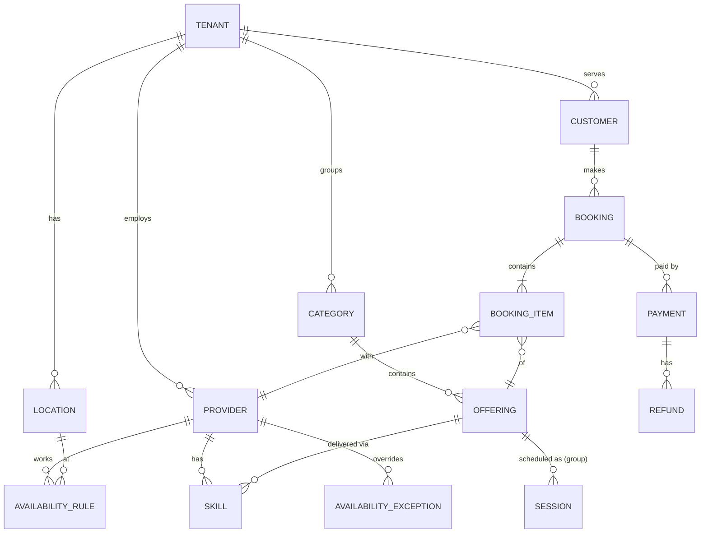
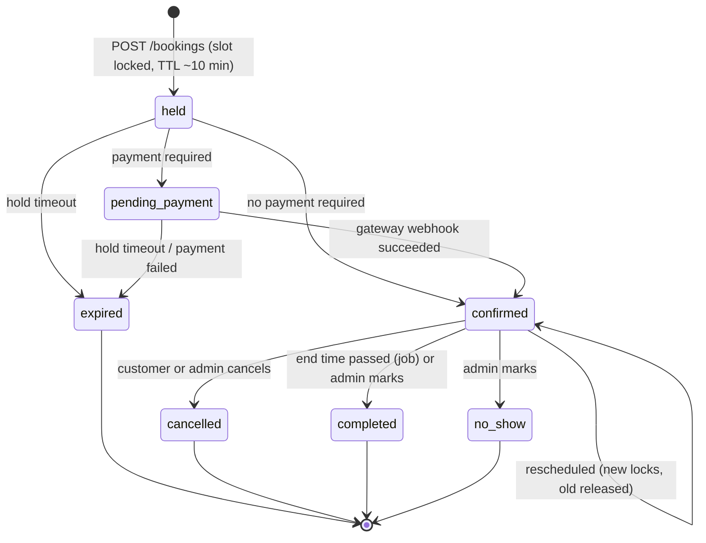
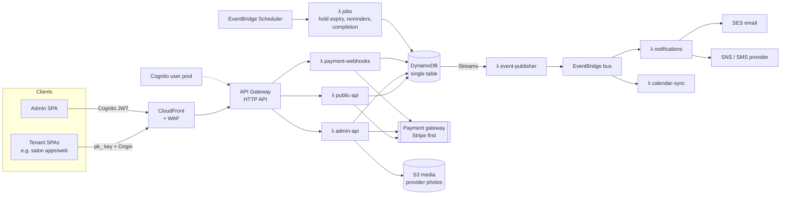

# Bookings & Payments Backend — Design

> Status: **draft design**. This backend will live in its own repository. This document captures the
> design so the salon SPA in this repo (and other lightweight frontends) can be built against it.

## 1. Purpose and scope

A **headless, multi-tenant booking and payments platform**. Businesses that sell time with a person
(hair stylists, language coaches, therapists, yoga teachers, mentors, personal trainers, tutors, …)
configure their offerings, people, availability and prices in an admin app. Their customer-facing
frontends, which are typically small static SPAs like `apps/web` here, call a public REST API to show
availability, take bookings and collect payment.

**Fixed technology choices**

- **DynamoDB** for all transactional data (single-table design)
- **REST APIs on AWS Lambda** behind API Gateway
- An **admin frontend** (SPA) for business owners and their staff

**Goals**

- One deployment serves many independent businesses (tenants), fully isolated from one another.
- The domain model is vertical-agnostic: no salon-specific (or therapy-specific) code paths. Per-vertical
  differences are configuration and data, not code.
- A public API that a static frontend can call directly from the browser, with no backend of its own.
- Payment processing behind a provider-agnostic port, with Stripe as the first adapter.
- Close to £0 when idle (pay-per-request everything).

**Non-goals (for now)**

- Hosting tenants' marketing websites (the frontends are theirs).
- Point of sale, retail inventory, payroll and commission accounting.
- Video conferencing. For online sessions we store and send a meeting link (Zoom, Meet, Teams) and
  don't host the call.
- A consumer marketplace for discovering businesses. See the roadmap.

## 2. Domain model

### 2.1 Vocabulary

The salon SPA uses salon words (`Stylist`, `Service`). The platform uses neutral words:

| Platform term | Salon | Language school | Therapy practice | Yoga studio | Mentoring |
|---|---|---|---|---|---|
| **Tenant** | Canary Wharf Salon | Lingua Club | Riverside Therapy | Flow Yoga | Jane Doe Mentoring |
| **Location** | Canary Wharf branch | Online; Shoreditch office | Room at clinic; Online | Studio 1 | Online |
| **Provider** | Stylist (Elena) | Coach | Therapist | Teacher | Mentor (Jane) |
| **Offering** | Balayage, 180 min | 60-min Spanish conversation | 50-min CBT session | Vinyasa class (20 places) | 6-session programme |
| **Skill** | Elena does balayage at £150 | Coach teaches Spanish B1–C1 | Therapist offers couples work | Teacher teaches Vinyasa | Jane offers career mentoring |
| **Resource** (optional) | Colour chair, basin | — | Consulting room | Studio room, mats | — |

A sole trader is a tenant with one provider and usually one location. Nothing in the model assumes a team.

### 2.2 Entities



**Tenant**: a business. Holds its name, slug, default currency (ISO 4217), default timezone, branding,
policies (§2.5), publishable API keys, allowed origins, notification templates, payment-gateway
connection and `intakeForm` definitions.

**Location**: where an offering is delivered, with a `kind`:
- `physical`: address, geo-coordinates, opening hours by day of week, IANA timezone.
- `online`: a default meeting URL, or the provider's personal meeting URL is used.
- `client-address`: mobile services (home hairdressing, home tutoring). The customer supplies an
  address and an optional travel buffer applies.

Every location has a **timezone**. All availability is computed in the location's local time.

**Provider**: a bookable person. Name, display role/title, bio, photo, `level` / pricing tier (e.g.
`junior`, `senior`, `director`), `active`, `bookableOnline`, optional linked admin user (so the provider
can log in and manage their own diary), optional `meetingUrl`, `attributes`.

**Category**: a display grouping for offerings ("Cut & Style", "Colour").

**Offering**: what is sold.
- `name`, `description`, `categoryId`, `durationMin`, `bufferBeforeMin`, `bufferAfterMin`
  (clean-up or processing time that blocks the provider but isn't shown to the customer).
- `mode`:
  - `appointment`: 1:1 (or 1:small fixed party), built from the provider's free time.
  - `class`: a scheduled **Session** with a capacity (yoga class, group language class).
  - `package`: a bundle of N credits for another offering (e.g. a 6-session mentoring programme or a
    10-class pass), sold up front and redeemed per booking.
- `basePrice` (minor units) and `currency`, optional `priceFrom` display flag ("from £65").
- `locationIds` where it's offered.
- `requiredResourceKinds` (optional, e.g. a `room`).
- `policyOverrides`, so an offering can have a stricter deposit or cancellation rule than the tenant default.
- `intakeFormId` (optional) and `attributes`.

**Skill**: the Provider ↔ Offering link. This is where most per-person variation lives:
- `priceOverride` (minor units) for when this person charges a different amount,
- `durationOverrideMin` for a faster or slower provider,
- `level` / proficiency (e.g. language CEFR range, "trainee"),
- `onlineOnly` / `locationIds` restriction.

**Price resolution:** `skill.priceOverride` → tenant price table for `offering × provider.level`
→ `offering.basePrice`. The same order applies to duration. This covers "senior stylist costs more",
"this coach is cheaper" and flat-price businesses without special cases.

**Availability rule**: recurring weekly working time for a provider at a location:
`{ providerId, locationId, dayOfWeek, start: "09:00", end: "13:00", validFrom?, validTo? }`.
Several rules per day allow split shifts, and different locations on different days ("Tue/Wed Canary
Wharf, Thu online"). Times are local wall-clock times in the location's timezone, so DST is handled
when slots are computed.

**Availability exception**: a date-specific override: `{ providerId, date, kind: "off" | "extra",
start?, end?, locationId?, reason }` for holidays, sickness, training days and extra shifts. Tenant-wide
and location-wide closures (bank holidays) are exceptions with no `providerId`.

**Resource** (optional, v3): a countable thing that also has to be free, such as a room or chair. Most
tenants never use it.

**Session** (class mode): a dated occurrence of a class offering: `{ offeringId, providerId,
locationId, start, end, capacity, seatsTaken }`. Generated from a recurring schedule or created ad hoc.

**Customer**: scoped to a tenant (the same person at two businesses is two customers). Name, email,
phone, marketing consent, notes, `attributes` (e.g. patch-test date, language level), and package
credit balances.

**Booking**: one customer, one checkout. Holds a human-readable `reference` (e.g. `CWS-7K2P9Q`),
status, `items[]`, totals, the policy snapshot applied at the time, intake answers, `source`
(`web`, `admin`, `phone`), and a hashed `manageToken` for the customer's self-service link.

**Booking item**: one offering with one provider at one time:
`{ offeringId, providerId, locationId, start, end, price, sessionId? }`. A multi-service salon visit
("cut + toner") is one booking with two back-to-back items, which is what the SPA does today.

**Payment / Refund**: a record of money movement mirrored from the gateway (§8).

### 2.3 Extensibility without code

Verticals differ in what they need to know, not in how booking works. Two mechanisms cover this:

1. **`attributes`**: a free-form, size-limited `map<string, string | number | boolean>` on Provider,
   Offering, Customer and Booking. Frontends can show it, and the admin app can edit it.
2. **Intake forms**: a tenant defines a JSON-Schema-like form (`fields: [{ id, label, type, required,
   options }]`) and attaches it to offerings. The public API returns the form with the catalogue, and the
   frontend renders it on the details step. Answers are stored on the booking. Examples: therapy intake
   questions, "date of last patch test" for colour, "current language level", "goals for this mentoring
   session".

Sensitive answers (therapy) are flagged `sensitive: true`. They are encrypted at the application level
with a KMS key, excluded from list views and logs, and visible only to the owner and the assigned provider.

### 2.4 Booking lifecycle



- **Held** reserves the slot while the customer pays. Only `confirmed`, `completed` and `no_show`
  bookings count as real diary entries. `held` and `pending_payment` block the slot only until expiry.
- Every transition emits a domain event (§3), and each one is recorded in the booking's audit trail.

### 2.5 Policies

Tenant defaults, overridable per offering. A snapshot is copied onto each booking so later changes
don't alter existing bookings:

- `minLeadTimeMin` (e.g. no bookings within 2 h), `maxHorizonDays` (e.g. 60 days ahead)
- `slotIntervalMin` (start-time granularity shown to customers: 15 or 30)
- `cancellationWindowHours` and what happens inside it (no refund, fee, deposit kept)
- `payment`: `none` | `deposit { fixed | percent }` | `full` | `card_on_file { noShowFee }`
- `requiresApproval` (some therapists and mentors approve requests manually, in which case the booking
  waits in `held` with a longer TTL as a request)
- `allowAnyProvider` ("no preference" option in the frontend)

## 3. Architecture



- **Runtime**: Node.js 22 + TypeScript on Lambda (arm64), sharing types with frontends. A Lambda per
  surface (`public-api`, `admin-api`, `payment-webhooks`, `jobs`, `notifications`, `event-publisher`,
  `calendar-sync`), each with a small router inside rather than a Lambda per route. That keeps cold
  starts and deployment surface small.
- **Code layout**: hexagonal. `domain/` (pure: availability, pricing, policies, state machine) ←
  `app/` (use cases) ← `adapters/` (DynamoDB repositories, payment gateways, email, HTTP handlers).
  The availability engine is pure functions and is unit-tested heavily, as `packages/booking/src/mock.ts`
  is today.
- **Events**: DynamoDB Streams → `event-publisher` → EventBridge (`booking.held`, `booking.confirmed`,
  `booking.cancelled`, `booking.rescheduled`, `payment.succeeded`, `payment.refunded`, …). Side effects
  (email, SMS, calendar sync, analytics, tenant webhooks later) subscribe without coupling to the write path.
- **Scheduled work**: EventBridge Scheduler one-off schedules per booking (hold expiry, 24 h reminder)
  plus a nightly sweep as a safety net.
- **IaC**: AWS SAM / CloudFormation (matching `infra/site.yml` in this repo), region **eu-west-2**,
  separate `dev`, `staging` and `prod` accounts or stacks. CI deploys via GitHub Actions with OIDC.
- **API contract**: an OpenAPI 3.1 spec in the backend repo is the source of truth. Request validation,
  a generated TypeScript client and docs come from it.

## 4. Multi-tenancy and auth

### 4.1 Tenant isolation

- Every item's partition key starts with `TENANT#<tenantId>` (§5). There are no cross-tenant queries on
  the request path.
- A single data-access layer takes `tenantId` from the authenticated context, never from the request
  body, and builds every key. Repository functions can't be called without it.
- Defence in depth (later): per-surface IAM roles with a `dynamodb:LeadingKeys` condition via
  session-scoped credentials for admin requests.

### 4.2 Public API (tenant frontends)

- Identified by a **publishable key** `pk_live_…` / `pk_test_…` sent as the `X-Api-Key` header. It's safe
  to embed in a static SPA because it only grants public operations.
- Each key has an **allowed-origins** list that drives CORS and is checked against `Origin`.
- **Rate limits**: per key and per IP (WAF rate-based rules + API Gateway throttling). Booking creation
  is additionally protected by an optional Cloudflare Turnstile / hCaptcha token if a tenant sees abuse.
- **`test` mode** keys hit the same stack but are flagged. Bookings are marked as test and payments
  go to the gateway's test mode. This replaces the SPA's current `isDemo` banner.

### 4.3 Admin API

- **Cognito** user pool (email + password, MFA optional for owners). The JWT carries
  `custom:tenantId` and `custom:role`. A user can belong to several tenants through a membership item,
  and the admin app has a tenant switcher.
- Roles:
  - `owner`: everything, including payments, payouts, API keys and staff.
  - `manager`: catalogue, providers, availability, all bookings and refunds.
  - `provider`: own profile, own availability and exceptions, own diary, and marking own bookings
    completed or no-show.
- Platform super-admin (us) is a separate Cognito group used only through an internal ops surface.

### 4.4 Customers

No customer accounts in v1. The confirmation email contains a **manage link**
(`/manage/<reference>?t=<token>`) that lets the customer view, cancel or reschedule. The token is random,
256-bit and stored hashed. Customer accounts or passwordless login are a later option (§12).

## 5. DynamoDB single-table design

One table, `bookings-<env>`, on-demand capacity, PITR on, TTL attribute `ttl`, Streams
`NEW_AND_OLD_IMAGES`.

### 5.1 Items

| Entity | PK | SK | Notes |
|---|---|---|---|
| Tenant | `TENANT#t` | `META` | settings, policies, branding |
| Membership | `USER#u` | `TENANT#t` | admin user ↔ tenant + role |
| API key | `APIKEY#<hash>` | `META` | → tenantId, mode, allowed origins |
| Location | `TENANT#t` | `LOC#l` | |
| Category | `TENANT#t` | `CAT#c` | |
| Offering | `TENANT#t` | `OFFER#o` | |
| Provider | `TENANT#t` | `PROV#p` | |
| Skill | `TENANT#t` | `PROV#p#SKILL#o` | price/duration overrides |
| Availability rule | `TENANT#t` | `PROV#p#RULE#<ruleId>` | |
| Exception | `TENANT#t` | `EXC#<date>#<providerId or *>` | range query by date |
| Catalogue snapshot | `TENANT#t` | `CATALOG#v<n>` | denormalised read model (§5.4) |
| Customer | `TENANT#t` | `CUST#c` | |
| Booking | `TENANT#t#BOOKING#b` | `META` | header, status, totals |
| Booking item | `TENANT#t#BOOKING#b` | `ITEM#n` | carries GSI1/GSI2/GSI4 keys |
| Payment | `TENANT#t#BOOKING#b` | `PAY#<id>` | |
| Refund | `TENANT#t#BOOKING#b` | `REFUND#<id>` | |
| Audit event | `TENANT#t#BOOKING#b` | `EVT#<iso>#<seq>` | |
| Slot lock | `TENANT#t#PROV#p#DAY#<date>` | `SLOT#<HH:mm>` | §5.3 |
| Class session | `TENANT#t#SESSION#s` | `META` | capacity, seatsTaken |
| Idempotency record | `TENANT#t#IDEM#<key>` | `META` | cached response, TTL 24 h |
| Gateway event | `GWEVT#<gateway>#<eventId>` | `META` | webhook de-duplication, TTL 30 d |

All tenant configuration lives in one partition (`TENANT#t`), so loading the whole catalogue is one
`Query`. Busy data (bookings and locks) is spread across many partitions to avoid hot keys.

### 5.2 Global secondary indexes

| GSI | PK | SK | Serves |
|---|---|---|---|
| GSI1 diary | `TENANT#t#PROV#p` | `START#<iso>` | provider diary for a date range, availability conflicts |
| GSI2 customer | `TENANT#t#CUST#c` | `START#<iso>` | customer history |
| GSI3 lookup | `REF#<reference>` / `GWPI#<paymentIntentId>` | `META` | manage link, webhook → booking |
| GSI4 tenant timeline | `TENANT#t#DAY#<date>` | `START#<iso>#<b>` | admin "today" view across providers, sessions by day |

Booking items are projected to GSI1 once per booking item (one per provider involved), which is why a
booking's per-item rows (`SK = ITEM#n`) carry the GSI1 attributes and the `META` row doesn't.

### 5.3 Preventing double booking

The availability API is advisory. **The write path is authoritative.** A booking is created with a single
`TransactWriteItems` that contains:

1. the booking `META` and `ITEM#n` rows (`attribute_not_exists(PK)`), and
2. one **slot lock** per 5-minute granule occupied by each item, including buffers, for that provider:
   `PK = TENANT#t#PROV#p#DAY#2026-11-24, SK = SLOT#14:05`, with condition
   `attribute_not_exists(PK) OR (status = "held" AND expiresAt < :now)`.

If any lock exists, the transaction fails with `ConditionalCheckFailed` and the API returns
`409 slot_unavailable`, which the SPA already maps to `SlotUnavailableError`.

- **Granule** is 5 minutes so that offering durations and buffers don't need to align to the 15/30-minute
  display interval. A 3 h balayage + 15 min buffer = 39 locks. The DynamoDB limit of 100 items per
  transaction allows ~8 h of continuous booking per transaction. Longer items (rare: full-day
  workshops) use the class/session path instead.
- **Holds**: locks for `held` bookings carry `status: "held"`, `expiresAt` and a `ttl`. Because DynamoDB TTL
  deletion is lazy (it can take hours), the condition above treats expired holds as free rather than
  relying on deletion. On confirmation, the locks are updated to `status: "confirmed"` and `ttl` is removed.
- **Cancel/reschedule** deletes the old locks and writes the new ones in one transaction.
- **Resources** (v3) use the same pattern with `PK = TENANT#t#RES#r#DAY#date`.
- **Class sessions** use a counter instead of locks:
  `UpdateItem SET seatsTaken = seatsTaken + :n IF seatsTaken + :n <= capacity`, in the same transaction as
  the booking.

### 5.4 Read models and caching

- **Catalogue snapshot**: on any admin change to locations, offerings, providers, skills or policies, the
  admin API rebuilds a single denormalised JSON item (`CATALOG#v<n>`, under 400 KB) with prices already
  resolved per provider. `GET /catalog` is one `GetItem`, cached at CloudFront for 60 s with the version in
  an `ETag`.
- **Availability** is computed on request from rules, exceptions and one `Query` per provider on GSI1 for
  the date range. It's cached at the edge for 15–30 s per query string. Stale results are acceptable
  because the write path is authoritative.

## 6. Availability algorithm

Pure function, shared by `GET availability/dates` and `GET availability/slots`:

```
input:  tenant policies, location (tz, opening hours), offerings[] requested,
        candidate providers (one, or all with skills for every offering when "any"),
        rules, exceptions, existing busy intervals (confirmed + unexpired holds), date range, now
for each date in range (location-local):
  if outside [now + minLeadTime, now + maxHorizon] or location closed → "closed"
  for each candidate provider:
    working = ∪ rules for that weekday/location  − exceptions(off)  + exceptions(extra)
    working = working ∩ location opening hours
    free    = working − busy intervals
    total   = Σ (resolved duration + buffers) of requested offerings, back-to-back
    starts  = every slotIntervalMin step s where [s, s + total) ⊆ free and s ≥ now + minLeadTime
  slot list = union of starts → TimeSlot { time, providerIds[] }
  day status = "available" if any slot, else "fully-booked" if any provider was working, else "closed"
```

- All arithmetic happens in the **location's timezone**. Rules are local wall-clock times, so a 09:00 shift
  stays 09:00 across the clocks changing. Instants are stored and returned as ISO 8601 with offset.
- Multi-offering bookings go to one provider back to back (current SPA behaviour). Splitting across
  providers (e.g. colourist then stylist) is a later extension: the items already carry their own `providerId`.
- "Any provider": the slot carries every free `providerId`. At booking time the server picks one using a
  tenant strategy (`least_busy` by default, or `round_robin` or `priority`), so the frontend doesn't choose.
- Output shapes match the SPA's `DayAvailability[]` and `TimeSlot[]` (`stylistIds` ↔ `providerIds`).

## 7. REST API

Base URL: `https://api.<platform-domain>/v1`. JSON throughout.

### 7.1 Conventions

- **Dates** `YYYY-MM-DD` and **times** `HH:mm` are local to the location. **Instants** are ISO 8601 with
  offset. **Timezones** are IANA names.
- **Money** is integer minor units plus currency: `{ "amount": 6500, "currency": "GBP" }`.
- **Idempotency**: `Idempotency-Key` header required on `POST` booking and payment endpoints. Responses are
  stored for 24 h and replayed.
- **Pagination**: `?limit=&cursor=` with `nextCursor` in the response.
- **Errors**: RFC 9457 `application/problem+json` with a stable `code`, e.g. `slot_unavailable` (409),
  `outside_booking_window` (422), `payment_required` (402), `invalid_api_key` (401), `forbidden_origin` (403).
- **Versioning**: URI major version (`/v1`). Additive changes only within a version.

### 7.2 Public API (publishable key)

| Method | Path | Purpose |
|---|---|---|
| GET | `/catalog?locationId=` | tenant name, locations, categories, offerings, providers (with resolved prices/skills), opening hours, policies, intake forms |
| GET | `/availability/dates?offeringIds=&providerId=&locationId=&from=&to=` | `DayAvailability[]` |
| GET | `/availability/slots?offeringIds=&providerId=&locationId=&date=` | `TimeSlot[]` |
| GET | `/sessions?offeringId=&from=&to=` | class sessions with seats left |
| POST | `/bookings` | create a **hold**. Body: items or a slot selection, customer, intake answers. Returns booking, `expiresAt` and, if payment is required, a `payment` object (`gateway`, `clientSecret` / redirect URL) |
| POST | `/bookings/{id}/confirm` | confirm a hold that needs no payment (also used after a client-side payment confirm, but the webhook stays authoritative) |
| GET | `/bookings/{reference}?token=` | manage link: view |
| POST | `/bookings/{reference}/cancel?token=` | cancel, applying the policy (refund or fee) |
| POST | `/bookings/{reference}/reschedule?token=` | move to a new slot |

Minimal `POST /bookings` request (matches today's `BookingRequest`):

```json
{
  "locationId": "canary-wharf",
  "providerId": null,
  "offeringIds": ["womens-cut", "toner-gloss"],
  "date": "2026-11-24",
  "time": "14:00",
  "customer": { "name": "Ana", "email": "ana@example.com", "phone": "+447700900000", "notes": "" },
  "intake": {}
}
```

Response (superset of today's `BookingConfirmation`):

```json
{
  "id": "bk_01JD…",
  "reference": "CWS-7K2P9Q",
  "status": "confirmed",
  "providerId": "elena",
  "items": [
    { "offeringId": "womens-cut", "providerId": "elena", "start": "2026-11-24T14:00:00Z", "end": "2026-11-24T15:00:00Z", "price": { "amount": 6500, "currency": "GBP" } },
    { "offeringId": "toner-gloss", "providerId": "elena", "start": "2026-11-24T15:00:00Z", "end": "2026-11-24T15:30:00Z", "price": { "amount": 3500, "currency": "GBP" } }
  ],
  "date": "2026-11-24", "time": "14:00", "endTime": "15:30", "durationMin": 90,
  "total": { "amount": 10000, "currency": "GBP" },
  "amountDue": { "amount": 0, "currency": "GBP" },
  "payment": null
}
```

### 7.3 Admin API (Cognito JWT)

All under `/admin`, scoped to the caller's tenant and filtered by role:

| Resource | Endpoints |
|---|---|
| Tenant & settings | `GET/PATCH /admin/tenant`, `GET/PATCH /admin/tenant/policies`, `…/branding`, `…/notifications` |
| API keys | `GET/POST /admin/api-keys`, `DELETE /admin/api-keys/{id}`, allowed origins |
| Staff | `GET/POST /admin/users`, `PATCH/DELETE /admin/users/{id}` (invite via Cognito) |
| Locations | CRUD `/admin/locations` |
| Categories, offerings | CRUD `/admin/categories`, `/admin/offerings` |
| Providers | CRUD `/admin/providers`, `PUT /admin/providers/{id}/photo` (S3 presigned upload) |
| Skills | `GET/PUT /admin/providers/{id}/skills` (bulk replace of the matrix row) |
| Availability | CRUD `/admin/providers/{id}/rules`, CRUD `/admin/exceptions` |
| Sessions | CRUD `/admin/sessions`, recurring schedule generator |
| Diary | `GET /admin/diary?from=&to=&providerId=&locationId=` |
| Bookings | `GET /admin/bookings` (filters), `POST /admin/bookings` (manual/phone, can override availability with explicit flag), `PATCH …/{id}` (status: completed/no_show), `POST …/{id}/cancel`, `…/reschedule` |
| Customers | `GET /admin/customers`, `GET/PATCH …/{id}`, `GET …/{id}/export`, `DELETE …/{id}` (GDPR erase) |
| Payments | `GET /admin/payments`, `POST /admin/bookings/{id}/refunds`, `POST /admin/bookings/{id}/charge-no-show`, `GET/POST /admin/payments/connection` (gateway onboarding) |
| Reports | `GET /admin/reports/summary?from=&to=` (bookings, revenue, utilisation per provider) |

### 7.4 Webhooks

`POST /webhooks/payments/{gateway}`: unauthenticated route, verified by the adapter's signature check
(§8). Later: outbound **tenant webhooks** (subscribe to `booking.*` events) for tenants with their own systems.

## 8. Payments (provider-agnostic)

### 8.1 The port

```ts
interface PaymentGateway {
  readonly id: "stripe" | "square" | "gocardless" | string;
  onboardTenant(tenant): Promise<{ accountRef: string; onboardingUrl: string }>;
  createPayment(req: {
    tenantAccountRef: string; amount: Money; captureMode: "automatic" | "manual";
    saveMethod?: boolean; customer: CustomerRef; bookingId: string; idempotencyKey: string;
    platformFee?: Money;
  }): Promise<{ paymentRef: string; clientAction: ClientAction }>; // clientSecret | redirectUrl
  capture(paymentRef: string, amount?: Money): Promise<void>;
  chargeSavedMethod(req): Promise<{ paymentRef: string }>;     // no-show / late-cancel fee
  refund(paymentRef: string, amount: Money, reason: string): Promise<{ refundRef: string }>;
  parseWebhook(headers, rawBody): Promise<GatewayEvent>;        // verifies signature, normalises
}
```

- The core domain only ever sees normalised `GatewayEvent`s (`payment.succeeded`, `payment.failed`,
  `refund.succeeded`, `dispute.opened`, `account.updated`) and our own `Payment` / `Refund` records.
- Each tenant chooses one gateway connection, stored as `{ gateway, accountRef, status, capabilities }`.
  Credentials for the platform's gateway accounts are kept in Secrets Manager.
- **Stripe is the first adapter**, using **Stripe Connect** (Express accounts): each tenant is a
  connected account, funds settle to them directly, and the platform can take an `application_fee`.
  Payments use Payment Intents with Payment Element on the frontend (cards, Apple/Google Pay).
- Later candidates: Square (salons often already use it), GoCardless (recurring coaching
  subscriptions), PayPal.

### 8.2 Flows by policy

| Policy | At booking | Later |
|---|---|---|
| `none` | confirm immediately | pay at venue (admin can record cash/card-terminal payment manually) |
| `deposit` | charge deposit, confirm on webhook | remainder at venue; deposit refunded or kept per cancellation policy |
| `full` | charge total, confirm on webhook | refund per cancellation policy |
| `card_on_file` | save the payment method (SetupIntent), confirm on webhook | admin can charge no-show / late-cancel fee |
| package credit | decrement credit (conditional update in booking transaction) | credit restored on in-window cancellation |

### 8.3 Rules

- **Webhooks are the source of truth.** The frontend's "payment complete" redirect only triggers a
  status poll. Webhook handling is idempotent: a `GWEVT#…` item is written with
  `attribute_not_exists` first, and duplicates are acknowledged and ignored.
- A payment that succeeds **after** its hold expired and the slot was taken triggers an automatic refund
  and a notification. This is rare, and it's why hold TTLs (~10 min) exceed typical checkout times.
- No card data touches our systems: hosted fields / Payment Element only (PCI DSS **SAQ A**).
- Money is integer minor units everywhere. Tax: prices are VAT-inclusive by default, with a per-tenant
  `vatRegistered` flag and rate for receipts (see open questions).

## 9. Admin frontend

A separate SPA (React + Vite + TypeScript + Tailwind, matching this repo), hosted on S3 + CloudFront
like the salon site, talking only to `/admin` endpoints.

- **Diary**: day and week calendar per provider or location, drag to reschedule, click to create a
  phone booking, colour by status, class sessions with seat counts.
- **Bookings & customers**: search, booking detail with audit trail, payments and refunds, customer
  profile and history, GDPR export/erase.
- **Catalogue**: categories, offerings (duration, buffers, mode, price, policies, intake form), and the
  **skills matrix** (providers × offerings grid with price/duration overrides).
- **Team**: provider profiles (photo, bio, level, meeting link), staff invites and roles.
- **Availability**: weekly rota editor per provider/location, exceptions calendar (holidays, sickness),
  tenant closures.
- **Settings**: business details, locations and opening hours, policies, branding, notification
  templates, payment-gateway onboarding, API keys and allowed origins, test/live mode.
- **Reports**: bookings, revenue, no-show rate, utilisation per provider.
- Role-aware: a `provider` sees only their diary, availability and profile.

## 10. Integration with this salon SPA

The SPA already talks to an abstract `BookingProvider` (`packages/booking/src/types.ts`), so the switch is
contained:

1. Add `createRestProvider({ baseUrl, apiKey, locationId })` to `packages/booking`, implementing
   `getCatalog`, `getAvailableDates`, `getTimeSlots` and `createBooking` against §7.2. It maps names
   (`Provider` → `Stylist`, `Offering` → `Service`, `providerIds` → `stylistIds`) and money (minor units →
   whole pounds, until the SPA moves to minor units), and turns `409 slot_unavailable` into
   `SlotUnavailableError`.
2. Swap it in at `apps/web/src/booking/provider.ts` and set `isDemo = false` (or derive it from a `pk_test_` key).
3. Fold the static `catalog.ts` and the opening hours in `content.ts` into the tenant's data in the admin app.
4. When the tenant enables deposits or prepayment: add a **Payment** step after Details that mounts the
   gateway's client component using `payment.clientAction` and then polls the booking until `confirmed`.
5. Add a `/manage/:reference` route for the email manage link.

Eventually the types and REST client move to the backend repo and are published as a versioned SDK
(e.g. `@<org>/booking-client`), generated from the OpenAPI spec. The mock provider stays useful for
frontend development and tests.

## 11. Cross-cutting concerns

**Notifications.** SES for email (confirmation with `.ics` attachment, reminder 24 h before,
cancellation, reschedule, payment receipt), with per-tenant templates and sender name and a verified
sending domain on the platform domain. SMS reminders via SNS or a provider such as Twilio (opt-in, per
tenant). Provider notifications go to staff for new and cancelled bookings.

**Calendar sync (v3).** One-way push of a provider's bookings to Google/Outlook first. Optionally
two-way: read busy times from the provider's external calendar as extra busy intervals in §6, so a
mentor's personal calendar blocks slots.

**Observability.** Structured JSON logs (Powertools for AWS Lambda) with `tenantId`, `bookingId` and
`requestId`. X-Ray tracing. CloudWatch alarms on 5xx rate, p95 latency, DynamoDB throttles, webhook
failures and DLQ depth. EventBridge targets have DLQs.

**Security.** Least-privilege IAM per Lambda. WAF managed rules on CloudFront. Secrets in Secrets
Manager. KMS encryption for sensitive intake fields. Input validation from the OpenAPI schemas. Audit
trail of admin actions. Dependency scanning in CI.

**Privacy / GDPR.** Data stays in eu-west-2. The tenant is the data controller and the platform is the
processor (needs a DPA). Customer export and erase endpoints. Erase anonymises bookings but keeps
financial records for the statutory period. Configurable retention for intake answers.

**Resilience & data.** DynamoDB PITR plus scheduled on-demand backups. Infrastructure entirely in code.
`staging` mirrors `prod`.

**Testing.** Unit tests for the domain (availability, pricing resolution, policies, state machine), like
`packages/booking/src/mock.test.ts`. Integration tests against DynamoDB Local. Contract tests from the
OpenAPI spec. A concurrency test that fires parallel bookings for the same slot and expects exactly one
success. Stripe test-mode end-to-end tests in staging.

**Cost.** Lambda, API Gateway HTTP API, DynamoDB on-demand, EventBridge and SES are all pay-per-use.
Idle cost is close to zero (CloudWatch, Secrets Manager and WAF are the fixed costs). Low-volume tenants
cost pennies a month.

## 12. Roadmap

| Phase | Scope | Outcome |
|---|---|---|
| **v1** | Tenant/location/provider/offering/skill/rules/exceptions model; public API (catalog, availability, bookings, manage link); slot locking; email notifications; pay at venue; minimal admin (or seeded config) | salon SPA goes live on real data, replacing the mock |
| **v2** | Payment port + Stripe Connect adapter; deposits, full prepay, card-on-file no-show fees; full admin SPA; staff roles | online payments; business self-serve |
| **v3** | Class sessions, packages/credits, online and client-address locations, intake forms, calendar sync, resources, multi-location | yoga teachers, coaches, therapists, mentors onboard |
| **Later** | Waitlists, recurring bookings, subscriptions (GoCardless), tenant webhooks, reviews, customer accounts, embeddable booking widget, marketplace discovery | |

## 13. Open questions

1. **Tax**: is VAT-inclusive pricing with a per-tenant flag enough, or do any tenants need tax lines
   and invoices (e.g. B2B mentoring)?
2. **Calendar sync**: is one-way push enough for v3, or is reading providers' busy time essential
   (likely for mentors and therapists)?
3. **SMS**: SNS or a dedicated provider (Twilio, MessageBird) for UK sender IDs and delivery receipts?
4. **Customer accounts**: will any tenant need logged-in customers (package balances, history) before
   "Later"?
5. **Platform fees**: will the platform charge a per-booking application fee, a subscription per tenant,
   or both? This affects the Stripe Connect account type.
6. **Approval-required bookings** (therapy, mentoring): how long should a request hold the slot, and
   should a request take payment authorisation up front?
7. **Domain and branding**: platform API domain, and whether tenants want custom domains for the
   manage-booking pages and email sending.
